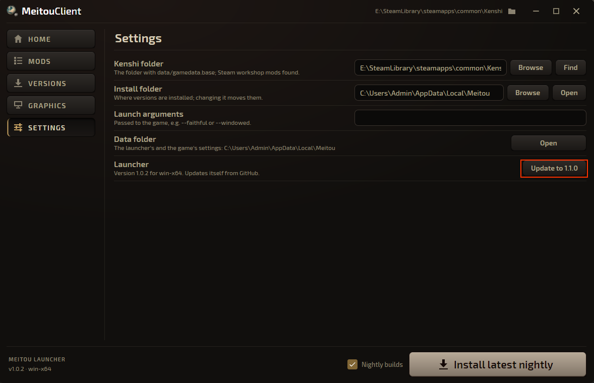

Work on **0.15** is still ongoing, and tonight's nightly build should be a real good one 😎 - we release it at 02:00 UTC each night, so stay tuned for tomorrow. 

Many thanks again to all our testers, and especially to **demitrix2k** for a lot of work lately, on the Linux build and on
features across the game.

Older launchers **don't update themselves**. **Launcher 1.1.0** does: each time it starts, it installs the newest
launcher from the official GitHub releases, so you are always up to date and have every feature. You can turn this off in
**Settings** with "Update the launcher automatically".

To get 1.1.0 from an older launcher, open **Settings** and press the **Update to 1.1.0** button next to Launcher.

